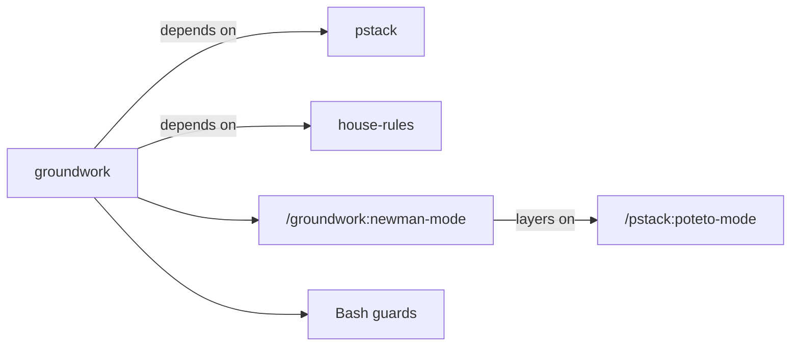

# groundwork

groundwork is a Claude Code plugin that makes an agent work the way Newman works. It ships one skill, `/groundwork:newman-mode`, and installs [pstack](https://github.com/cursor/plugins/tree/main/pstack) and house-rules beside it.



- **newman-mode** covers how to ask questions, when to act without asking, design defaults, verification, briefing subagents and the stacked-PR process. It overrides poteto-mode where they conflict.
- **pstack** provides the playbooks: poteto-mode, swarm, pause, orchestrate and the principle skills.
- **house-rules** blocks commits that break the commit-message preset and edits that add more than 5 comment lines per 100 new lines.
- **Agents** put cheaper models on cheaper work. `worker` is a copy of pstack's poteto-agent that hands back by about 40 tool calls. A hook tells `worker` to fold at 40 tool calls and `junior` at 30, and the caller escalates the receipt to a fresh, stronger agent. `junior` (Sonnet) takes mechanical leaves from `worker` and hands back at the first failure that has no one-line fix. `git` and `tracker` (Haiku) run git and issue-tracker operations whose inputs are already decided.
- **Agent guard** runs `Explore` on Sonnet and reroutes every `pstack:poteto-agent` spawn to `groundwork:worker`, and denies a `junior` spawn from anyone but `worker`. A `pstack:poteto-agent` or `worker` spawn without an explicit model is denied.
- **Bash guards** deny a piped command whose exit code would be hidden, and a slow or remote command (docker build, ssh, long runs) with no `timeout`.

## Install

```
claude plugin marketplace add IniZio/groundwork
claude plugin install groundwork@groundwork
```

The groundwork marketplace lists pstack straight from `cursor/plugins` main, so the install pulls it in. If you already have `pstack@cursor-plugins`, uninstall it so the `/pstack:` skills load once.

house-rules needs Claude Code v2.1.193 or later.

## Development

```
bun install
bun test
```

The `groundwork` marketplace can be a `directory` source pointing at a checkout, so every session runs the working tree. Skills and hooks reload with the reload-plugins command.
